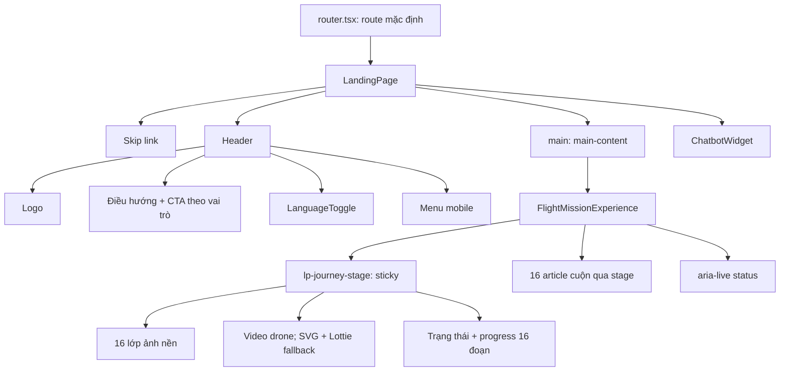
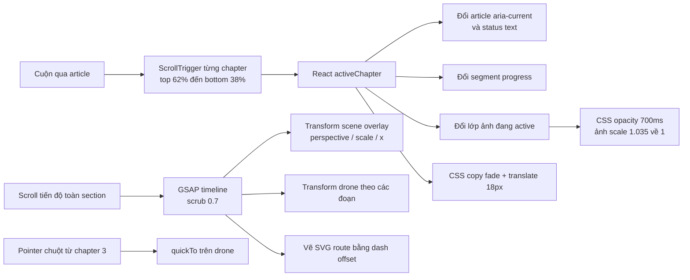

# Kiến trúc landing page hiện tại

**Phạm vi:** `ondemand-monitoring-web`; kiểm tra source và desktop render tại `localhost:5173` (khoảng 1270×720, tiếng Việt). Không sửa source, không chạy test suite. Hai ảnh tham khảo được nhắc trong brief không có file ảnh đính kèm trong phiên này; đánh giá hình ảnh dựa trên source, asset và desktop render.

## Tóm tắt

Landing page mặc định của ứng dụng React 19 + Vite 8 + TypeScript. `LandingPage` mount header, trải nghiệm sticky cuộn qua 16 chặng và chatbot. GSAP + ScrollTrigger scrub video 16 giây theo tiến độ; video ghép drone Blender với ảnh nền. Nếu video không tải được hoặc người dùng bật reduced motion, trang dùng SVG route và Lottie làm lớp dự phòng. Không có GLB được tải trên landing. CTA “Tạo yêu cầu” vẫn dùng điều hướng theo vai trò hiện hữu.

`README.md` còn ghi “Business features are intentionally not implemented yet”, nhưng source và test landing page đã có trải nghiệm này; README không phải mô tả đáng tin cậy về trạng thái hiện tại.

## Stack và điểm vào

- React 19, TypeScript, Vite 8; landing được trả về ở nhánh mặc định trong `src/app/router.tsx:399`.
- Có GSAP, `@gsap/react`, `lottie-react`, `motion`/`framer-motion`, Tailwind CSS v4 và Sass (`package.json`). Trang đang mount dùng GSAP, `@gsap/react`, Lottie và CSS riêng; không thấy Lenis, Three.js hay React Three Fiber trong dependency.
- `src/features/landing/landing.css` có 2.980 dòng. Quy tắc landing được thêm qua nhiều lớp (CSS nền, “v2”, cinematic flight, header refresh); một số selector `.lpx-*` thuộc bố cục cũ không được component hiện hành render.

## Component hierarchy đang chạy

## Scroll và animation flow

Hai hệ tiến độ chạy song song: `activeChapter` cập nhật từ trigger từng article; timeline khác scrub theo toàn section. Các mốc timeline viết theo tỷ lệ, chưa gắn tên chapter, nên cần đồng bộ rõ hơn nếu tinh chỉnh nhịp kể chuyện.

## Bảng kiến trúc

| Module / Component | File path | Chức năng | Dependencies | Animation hiện tại | Vấn đề phát hiện | Tái sử dụng / nâng cấp |
|---|---|---|---|---|---|---|
| Route mặc định | `src/app/router.tsx:399` | Chọn LandingPage ở route mặc định | Router ứng dụng | Không | README không phản ánh route này | Giữ route; cập nhật tài liệu dự án khi được yêu cầu |
| Trang và header | `src/features/landing/pages/LandingPage.tsx:34-139` | Logo, nav, ngôn ngữ, menu mobile, metadata, mount experience và chatbot | i18n, auth session, shared Icon, LanguageToggle | Menu đóng bằng Escape; nav CTA đổi theo user | Các CTA phải được giữ nguyên khi redesign | Header, skip link, metadata và role-aware CTA dùng lại được |
| Story copy 16 chặng | `src/features/landing/showcase/FlightMissionExperience.tsx` | Bản dịch VI/EN, tiêu đề, mô tả, trạng thái và ảnh từng cảnh | Copy props từ LandingPage | Chuyển theo activeChapter | Copy riêng chapter 1 không được render; JSX dùng hero props từ parent | Giữ data theo mảng; quản lý scene content/motion cùng nhau |
| Bộ điều phối story | `FlightMissionExperience.tsx` | Trigger chapter và master scrub timeline | GSAP, ScrollTrigger, useGSAP | Đồng bộ tiến độ video, status và progress; SVG/Lottie là fallback | Hai nguồn tiến độ vẫn tách giữa trigger chapter và timeline | Một progress model có label; tiếp tục dùng GSAP |
| Pointer follow | `FlightMissionExperience.tsx:404-509` | Drone phản hồi vị trí chuột; bỏ qua touch | GSAP quickTo | X/Y và nghiêng drone; cleanup event/tween | Chỉ bật từ chapter 3; cần giới hạn/tắt theo motion setting | Giữ như enhancer desktop; mobile đặt tĩnh |
| Stage và chapter markup | `FlightMissionExperience.tsx` | Backdrop, video, fallback route/drone, status, progress, 16 article, CTA cuối | Video, Lottie, React state, inline SVG | CSS crossfade và copy reveal | Link trong copy ẩn còn focus được; hai cảnh rail-yard có thể cùng active vì so URL | Tách nội dung semantic khỏi visual; active theo ID/index |
| Landing CSS | `src/features/landing/landing.css` | Layout, desktop/mobile, state, header, chatbot và legacy styles | CSS riêng; Tailwind không dựng story này | Sticky 100svh, ảnh fade/scale, copy fade/translate | 2.980 dòng, nhiều lớp và media query lặp | Chia stylesheet theo shell, story, header, assistant khi có baseline |
| Chatbot | `src/features/landing/components/ChatbotWidget.tsx:8-151` | FAB, hội thoại keyword, i18n, focus và Escape | React, chatbot messages | Reply trễ 450ms | Trả lời theo mẫu, không phải chatbot nối backend | Dùng độc lập; xác nhận nội dung trước khi thay đổi |
| MissionJourney (không mount) | `src/features/landing/showcase/MissionJourney.tsx` | Story prototype 4 chặng, trigger, Lottie | GSAP, Lottie, motion/react | Chapter active, drone từ chặng 3 | LandingPage không import | Tham khảo trigger/accessibility, không thay page |
| MonitoringJourney + media (không mount) | `MonitoringJourney.tsx`, `useJourneyPlayback.ts`, `InspectionMedia.tsx`, `media.ts` | Prototype request/scope/inspection/report, playback và responsive image | IntersectionObserver, React, srcSet 640/1280 WebP | Auto-play trong vùng nhìn; pause khi khuất tab/ngoài viewport/tương tác; reduced motion | REQ/checklist/status thuộc demo, không phải dữ liệu thật; không mount | Tham khảo pause rules và responsive assets; ghi nhãn minh họa |
| Section prototype khác | `ProductShowcase.tsx`, `WorkflowShowcase.tsx`, `ScrollReveal.tsx` | Prototype sản phẩm/workflow | React, CSS | Reveal/fade | Không được LandingPage import; docs cũ mô tả như phần hiện hành | Chọn lọc nếu roadmap thêm section |
| Asset và credit | `public/images/landing/*`; `src/features/landing/assets/drone-animation.json` | 4 JPG có credit metadata, 3 cặp WebP, Lottie | Lottie JSON, ảnh local | Lottie loop; crossfade ảnh | site-construction là CC BY 4.0 và yêu cầu credit; active component không render credit. WebP thiếu entry trong credits.json | Map ảnh → nguồn/license; thêm responsive srcset |

## Asset landing đã tìm thấy

| Asset | Kích thước trên disk | Ghi chú |
|---|---:|---|
| `rail-yard.jpg` | 614.569 B | Dùng cảnh 1 và 8; metadata ghi CC0 |
| `site-construction.jpg` | 1.029.016 B | Dùng cảnh 2; CC BY 4.0, cần attribution |
| `solar-field.jpg` | 1.093.296 B | Dùng cảnh 3; metadata ghi CC0 |
| `transmission-tower.jpg` | 620.180 B | Dùng cảnh 4; metadata ghi CC0 |
| `construction-640/1280.webp` | 92.464 / 353.276 B | Cảnh 5 |
| `infrastructure-640/1280.webp` | 49.294 / 180.380 B | Cảnh 6 |
| `landscape-640/1280.webp` | 93.226 / 316.764 B | Cảnh 7 |
| `drone-animation.json` | khoảng 214 KB | Lottie; không phải GLB |

Kích thước là bản local, không phải số đo tải mạng. Helper `media.ts` có srcSet nhưng active experience không gọi helper. Ảnh hiện có tên/mô tả phong cảnh, không chứng minh đây là chuyến bay hoặc khách hàng thật.

## Skill đã kiểm tra và áp dụng

| Skill | Vai trò | Giai đoạn | Trạng thái |
|---|---|---|---|
| `frontend-design` | Hình ảnh bám subject/asset thật, tránh hiệu ứng template | Creative direction | Có, đã đọc và áp dụng |
| `frontend-design-pro` | Quy trình phân tích, giới hạn phạm vi | Audit/plan | Có, đã đọc và áp dụng |
| `ui-ux-pro-max` | UX, responsive, motion; gợi ý cục bộ | Audit/plan | Có; đã đọc và chạy design-system, UX, React queries |
| `tailwind-design-system` | Kiểm tra tokens/Tailwind | Stack | Có, đã đọc; không dùng để triển khai vì task tài liệu và story dùng CSS riêng |
| `design-review` | Rubric đánh giá dựa trên bằng chứng | Visual review | Có; đã đọc rubric, dùng thang 1–10 theo brief |
| `frontend-design-review` | Craft, trust, friction | Visual/UX | Có, đã đọc và áp dụng |
| `ux-audit` | Phát hiện ưu tiên và hướng sửa | UX | Có, đã đọc và áp dụng |
| `ui-check` | Audit dựa trên render thật | Runtime evidence | Có; desktop đã xem, mobile runtime chưa xác minh |
| `accessibility` | Keyboard, focus, responsive, WCAG | A11y | Có, đã đọc và áp dụng |
| `webapp-testing` | Browser/test harness | Runtime | Có, đã đọc; không chạy test suite |
| `cinematic-scroll-storytelling` | Story tuyến tính, tránh scroll hijack/hiệu ứng dày | Storyboard | Có, đã đọc và áp dụng có chọn lọc |
| `gsap-scrolltrigger-storytelling` | Timeline có nhãn cảnh, cleanup, responsive | Motion architecture | Có, đã đọc và áp dụng |
| `gsap-scrolltrigger` / `gsap-performance` | Trigger lifecycle, transforms, quickTo | Motion/performance | Có, đã đọc và đối chiếu source |
| `accessible-animation` | Reduced motion theo tầng | Accessibility | Có, đã đọc và áp dụng |

Tra cứu `ui-ux-pro-max` nhấn mạnh keyboard access, motion sensitivity, dừng công việc ngoài khung hình và không gọi telemetry là live nếu thiếu data feed. Gợi ý HUD/sci-fi không được sao chép nguyên xi: story marketing không phải dashboard, status hiện tại là copy tĩnh.

## Sai lệch tài liệu và giới hạn

- `docs/landing-page-visual-storyboard.md`, `landing-page-content-strategy.md` và `landing-page-business-audit.md` mô tả landing 5 phần/4 chặng, credits và component không còn mount. Source hiện mount story 16 chapter, không có footer; các tài liệu đó vẫn lệch với source.
- CSS có lớp `.lpx-*` cho cấu trúc cũ và `.lp-*` cho experience hiện tại. Không xóa trong task này.
- Đã xem desktop render và kiểm tra CSS mobile; công cụ không đổi được viewport mobile trong phiên này, nên mobile runtime **chưa xác minh**.
- FPS, frame stability, memory, GPU, main-thread và network waterfall chưa đo; đánh giá performance là rủi ro từ cấu trúc code, không phải benchmark.
