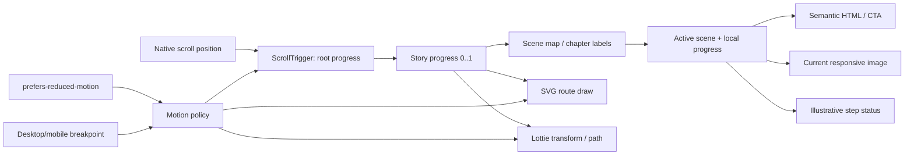

# Đề xuất kiến trúc kỹ thuật cho motion landing

## Ranh giới kiến trúc

Giữ React + GSAP + ScrollTrigger + Lottie hiện có. Không thêm thư viện chỉ để có hiệu ứng. Story vẫn là HTML có ngữ nghĩa; ảnh, route SVG và Lottie là lớp trang trí. Header, chatbot và CTA độc lập với scroll timeline.

## Mô hình dữ liệu và trạng thái

- Khai báo tám scene trong cấu hình đã bản dịch: ID, thứ tự, copy, asset/source, crop, status label, marker tùy chọn và asset credit.
- Dùng **một progress chính** [0..1] để lấy activeScene và local progress. Từ đây suy ra chapter active, progress indicator, backdrop và copy.
- Gắn timeline label theo scene ID thay vì mốc tùy ý như `0.08`, `0.24`, `0.41`. Giữ native scroll; không ép snap.
- Scene 1 cần source of truth rõ: `copy.chapters[0].title/body` không được render; JSX dùng hero props từ LandingPage.

## Sơ đồ đề xuất

## React và GSAP lifecycle

1. Dùng `useGSAP` làm entry point và đăng ký plugin một lần như hiện tại.
2. Dùng `gsap.matchMedia()` cho desktop/mobile và reduced-motion policy để setting đổi khi trang đang mở có hiệu lực.
3. Để `useGSAP` sở hữu trigger/timeline; callback/event custom có cleanup tương ứng. Source hiện cleanup pointer listener và `mm.revert()`; giữ pattern này.
4. Dùng `gsap.quickTo`/quickSetter cho input cập nhật thường xuyên, không tạo tween mới mỗi pointer event.
5. Animate `transform`/`opacity`; tránh `top`/`left`/`width`/`height` theo từng frame. Dùng `will-change` có chọn lọc.
6. Refresh ScrollTrigger sau khi ảnh/font làm layout thay đổi; tránh gọi liên tục khi resize.

## Component boundaries đề xuất

| Thành phần | Trách nhiệm |
|---|---|
| LandingPage | Ngôn ngữ, metadata, header, role-aware CTA, main landmark |
| FlightMissionExperience | Scene data, chapter semantics, active progress/status |
| MissionBackdrop (ý tưởng) | Ảnh active/crossfade, responsive sizes, decorative policy |
| FlightOverlay (ý tưởng) | SVG route + Lottie; aria-hidden, không chứa nội dung thao tác |
| MissionProgress (ý tưởng) | 16 chặng có label/current step, không chỉ span màu |
| ChatbotWidget | Hành vi riêng, không phụ thuộc GSAP |

Đây là ranh giới để roadmap, chưa tạo component mới.

## Kế hoạch asset

- Ảnh đầu eager/high priority; ảnh sau lazy-load theo scene gần tới. Mười sáu ảnh cùng nằm trong sticky stage nên cần xác minh bằng network waterfall.
- Dùng picture/srcSet/sizes cho WebP 640/1280. `media.ts` có `srcSet`, active story chưa dùng.
- Chỉ preload ảnh đầu và scene tiếp theo sau khi đo LCP; không preload đủ mười sáu ảnh.
- Map chapter → asset → credit/license; `credits.json` chưa liệt kê ba nhóm WebP và page không render credit.
- Video composite drone là lớp minh họa chính; reduced-motion hoặc lỗi tải dùng ảnh tĩnh, SVG và Lottie dự phòng. Không có GLB được tải trên landing.

## Responsive, reduced motion, accessibility

- **Desktop:** sticky stage hiện có, transforms nhỏ; pointer follow là enhancer tùy chọn.
- **Mobile:** native scroll; bỏ pointer follow, giảm parallax/perspective; không để status/chatbot che CTA. Nếu nội dung không vừa viewport, cho chapter tăng chiều cao tự nhiên.
- **Reduced motion:** tắt perspective/scale lớn/parallax/drone travel/route draw/auto-loop; cho người dùng cuộn nội dung tĩnh, vẫn thấy scene/progress. Theo dõi thay đổi setting trong session.
- **Focus:** CTA chapter ẩn không tabbable. Giữ nội dung đọc tuần tự cho screen reader; kiểm tra tab order, active focus và skip-link.
- **Status:** ghi rõ minh họa nếu không có data feed. Chỉ dùng aria-live khi thay đổi cần thông báo, tránh đọc lặp liên tục.
- **Contrast:** kiểm tra headline, status, index và focus ring trên crop sáng/tối.

## Performance validation trước khi thêm hiệu ứng

Benchmark trên desktop và mobile tầm trung: LCP ảnh hero, tải/decode ảnh, waterfall khi scroll, frame pacing lúc scrub, long task, layer/memory, resize refresh và reduced motion. Ghi viewport/device/browser/network; không báo “60fps” nếu chưa đo. Chỉ chọn thêm crossfade hai lớp, parallax, video hoặc asset nặng sau khi có dữ liệu.

## Không đề xuất cho MVP

- **Lenis:** chưa có trong package; landing đang dùng native scroll. Thêm smooth-scroll làm phức tạp sync/accessibility/reduced motion.
- **Three.js / React Three Fiber / shader:** chưa có model/texture có license; 3D giả không làm stock image liền mạch hơn.
- **Rive:** chưa có asset Rive; Lottie đã có drone minh họa.
- **Motion/Framer Motion cho scene chính:** package đã cài nhưng sẽ tạo thêm hệ motion cạnh GSAP mà không giải quyết đồng bộ story.
- **Scroll hijack và snap bắt buộc:** giảm quyền kiểm soát cuộn, nhất là mobile.
